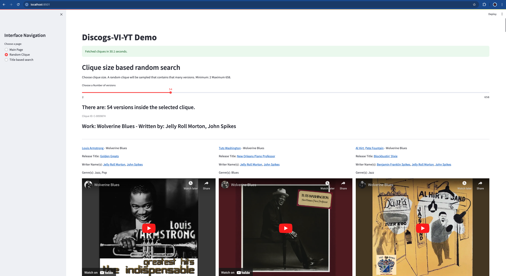

# Discogs-VI Dataset

[](https://doi.org/10.5281/zenodo.13983028)

> **New — Discogs-VI-SIREN**
> [](https://doi.org/10.5281/zenodo.21742034)
>
> *SImilar REgioNs between musical versions in Discogs-VI*: for pairs of
> versions of the same work, the regions where the two recordings correspond.
> We used [CLEWS](https://github.com/sony/clews) embeddings to locate them.
> An animation illustrating the similar regions is coming.

Discogs-VI is a dataset of [musical version](https://en.wikipedia.org/wiki/Cover_version) metadata and pre-computed audio representations, created for research on version identification (VI), also referred to as cover song identification (CSI). It was created using editorial metadata from the public [Discogs](https://discogs.com) music database by identifying version relationships among millions of tracks, utilizing metadata matching based on artist and writer credits as well as track title metadata. The identified versions comprise the *Discogs-VI* dataset, with a large portion of it mapped to official music uploads on YouTube, resulting in the *Discogs-VI-YT* subset.

In the VI literature the set of tracks that are versions of each other is defined as a *clique*. Here’s an example of the metadata for a [clique](./data/example_clique.json). *Discogs-VI* contains approximately 1.9 million versions belonging to around 348,000 cliques, while *Discogs-VI-YT* includes approximately 493,000 versions across about 98,000 cliques.

This website accompanies the dataset and the related publication, providing summary information, instructions on access and usage, as well as the code to re-create the dataset, including audio downloads from the matched YouTube videos. The code for dataset re-creation can be found [here](https://github.com/MTG/discogs-vi-dataset).

## Table of contents

* [Discogs](#discogs)
* [Dependencies](#dependencies)
* [Download](#download)
  * [Metadata](#1-metadata)
  * [Audio](#2-audio)
  * [Audio repesentations](#3-audio-representations)
* [Metadata Structure](#metadata)
  * [Main files](#main-files)
  * [Intermediary files](#intermediary-files)
  * [Loading with python](#loading-with-python)
* [Streamlit demo](#discogs-vi-yt-streamlit-demo)
* [Re-create the dataset](#re-create-the-dataset)
* [Cite](#cite)
* [License](#license)

## Discogs

Discogs regularly releases public [data dumps](https://www.discogs.com/data) containing comprehensive release metadata (such as artists, genres, styles, labels, release year, and country). See an [example](https://www.discogs.com/master/92381-Benny-Benassi-Hypnotica) of a release page. See how the Discogs database is built [here](https://support.discogs.com/hc/en-us/articles/360008545114-Overview-Of-How-DiscogsIs-Built). You can see some statistics for all music releases submitted to Discogs on their [explore page](https://www.discogs.com/search/).

## Dependencies

We use Python 3.10.9 on Linux.

```bash
git clone https://github.com/MTG/discogs-vi-dataset
cd discogs-vi-dataset
conda env create -f environment.yaml
conda activate discogs-vi-dataset
```

## Download

Three types of data are associated with the dataset:

1. Metadata
    * clique and version metadata (*Discogs-VI*),
    * clique and version metadata with only YouTube ID-matched versions (*Discogs-VI-YT*),
    * more metadata as explained in [this section](#metadata).
2. Audio
    * In the form of YouTube IDs. We do not share any audio.
3. Audio representations
    * audio representations such as CQT (Constant-Q Transform) extracted for the versions of Discogs-VI-YT.

This section provides details on how to access each. The details are provided in later sections.

### 1. Metadata

We provide the dataset including the intermediary files of the creation process. Due to their sizes, they are separated into two directories so that you do not have to download everything. If your goal is to use the dataset and start working, download `main.zip` (1.4 GB compressed, 21 GB uncompressed). If for some reason you are interested in the intermediary files, download `intermediary.zip` (8.7 GB compressed, 46 GB uncompressed). Contents of these folders are provided in [this section](#metadata). You can download these two zip files from [Zenodo](https://doi.org/10.5281/zenodo.13983028).

### 2. Audio

You can download the audio files corresponding to the YouTube IDs of the versions. In our experiments, we used exactly these IDs.

We have been able to conduct the downloads from our research institution under Directive (EU) 2019/790 on Copyright in the Digital Single Market, which includes text and data mining exceptions for the purposes of scientific research (Article 3).

```bash
python discogs_vi_yt/audio_download_yt/download_missing_version_youtube_urls.py Discogs-VI-YT-20240701.jsonl music_dir/
```

However, `Discogs-VI-20240701.jsonl.youtube_query_matched` contains more versions with YouTube IDs (read the paper for understanding why or check this [section](#main-files)).

```bash
python discogs_vi_yt/audio_download_yt/download_missing_version_youtube_urls.py Discogs-VI-20240701.jsonl.youtube_query_matched music_dir/
```

**NOTE**: We recommend parallelizing this operation because there are many audio files using `utilities/shuffle_and_split.sh`. However, if you use too many parallel processes you may get banned from YouTube. We experimented with 2-20 processes. Using more than 10 processes got us banned a few times. In that case, you should stop downloading and wait a couple of days before trying again.

```bash
utilities/shuffle_and_split.sh Discogs-VI-YT-20240701.jsonl 10
```

Then open up multiple terminal instances and call each split separately.

```bash
python discogs_vi_yt/audio_download_yt/download_missing_version_youtube_urls.py Discogs-VI-20240701.jsonl.youtube_query_matched.split.00 music_dir/
```

Once you finish downloading, there will be many versions who are the only downloaded versions from their clique, you should filter these out with `discogs_vi_yt/post_processing.py`. I recommend reading [here](README-recreate/#re-create-discogs-vi-yt) for more information.

**IMPORTANT NOTE**: Now that you have the data ready, you could start training VI models. However, in that case you would need validation and test sets. We provide **official** splits that consider Da-TACOS benchmark and SHS100K-TEST sets (Check [here](#metadata) or read the paper for more info). However, the audio files we could download are probably different than yours, so you will have to filter these files based on what you could download. You should use the following script to align your downloaded data to the official splits.

```bash
python utilities/align_to_official_splits.py /path/to/Discogs-VI-YT/main/ /path/to/videos/
```

This script will automatically align the train, val, and test splits and print statistics on what percentage of the data you could actually find. You should report these percentages if you publish a paper for accurate cocmparison.

### 3. Audio representations

This repository does not contain the code for extracting the CQT audio representations used to train the `Discogs-VINet` described in the paper, nor the features themselves. The model and code to extract the features are available in a separate [repository](https://github.com/raraz15/Discogs-VINet). The extracted features are available upon request for non-commercial scientific research purposes. Please contact [Music Technology Group](https://www.upf.edu/web/mtg/contact) to make a request.

## Metadata

Below you can find some information about the contents of the dataset and how to load them using Python.

### Main files

* `Discogs-VI-20240701.jsonl` corresponds to the *Discogs-VI* dataset which contains all identified cliques and their metadata. The versions are not matched to Youtube IDs.
* `Discogs-VI-YT-20240701.jsonl` corresponds to *Discogs-VI-YT* subset, with versions matched to YouTube IDs and with post-processing applied to ensure that each clique has at least two downloaded versions.
* However, we could match more videos than we could download in Barcelona between 2023-2024. Depending on your location, maybe you can download more than us. `Discogs-VI-20240701.jsonl.youtube_query_matched` contains all these YouTube IDs.
  * Some versions are matched to more than one alternative YouTube ID (1.4 videos per version on average) and the matches are sorted from the highest quality match to the lowest, although all YouTube IDs are official uploads.
* `Discogs-VI-20240701.jsonl` and `Discogs-VI-YT-20240701.jsonl` contain rich metadata and they are large in size (around 7 GB and 4 GB). Therefore we provide a file where only clique, version, and Youtube IDs are provided: `Discogs-VI-YT-light-20240701.json`. This file is the basis for training neural networks.
* We then create train, validation, and test partitions from `Discogs-VI-YT-light-20240701.json` after dealing with the test sets of the Da-TACOS and SHS100K datasets (see the paper for more information).
  * `Discogs-VI-YT-20240701-light.json.train`, `Discogs-VI-YT-20240701-light.json.val`, `Discogs-VI-YT-20240701-light.json.test`
* `discogs_20240701_artists.xml.jsonl.clean` contains detailed artist metadata that may be useful.
* `Discogs-VI-YT-20240701.jsonl.demo` is to be used with the Streamlit demo for visualization purposes.

**NOTE**: Every clique and version has a unique ID associated to them. Currently the clique IDs change between Discogs dumps (will be fixed in the code later).

### Intermediary files

* `discogs_20240701_artists.xml.jsonl` is the Discogs artist data dump xml file parsed to a jsonl file with some processing. It contains artist information such as aliases, group memberships, or name variations.
* `discogs_20240701_releases.xml.jsonl` is the Discogs release data dump xml file parsed releases to a jsonl file with some processing.
* `discogs_20240701_releases.xml.jsonl.clean` is the cleaned version.
* `discogs_20240701_releases.xml.jsonl.clean.tracks` contains the tracks from the clean releases. It is used for identifying the cliques.
* `Discogs-VI-20240701-DaTACOS-SHS100K2_TEST-lost_cliques.txt` contains the clique ids in Discogs-VI that intersect with Da-TACOS and SHS100K test sets.
* `Discogs-VI-20240701.jsonl.queries` contains the query strings that was created to search the versions on YouTube.

### Loading with python

The files have different encodings and structure. Here you can find how to load each file.

#### `Discogs-VI-20240701.jsonl`, `Discogs-VI-20240701.jsonl.youtube_query_matched`, and `Discogs-VI-YT-20240701.jsonl`

```python
# Read the file with utf-8 encoding
with open("Discogs-VI-YT-20240701.jsonl", encoding="utf-8") as in_f:
    # Read the file one line at a time
    for jsonline in in_f:
        # Load the clique
        clique = json.loads(jsonline)
        # Access the versions
        for version in clique["versions"]:
            # Access the urls or other metadata. For Discogs-VI-20240701.jsonl there are no youtube_video field
            for video in version["youtube_video"]:
                pass
```

#### `Discogs-VI-YT-20240701-light.json`, `Discogs-VI-YT-20240701-light.json.train`, `Discogs-VI-YT-20240701-light.json.val`, and `Discogs-VI-YT-20240701-light.json.test`

```python
# Read the file with default encoding
with open("Discogs-VI-YT-light-20240701.json") as in_f:
    # Load the cliques
    cliques = json.load(in_f)
# Access the data
```

#### Rest of the files

```python
with open("discogs_20240701_artists.xml.jsonl.clean", encoding="utf-8") as infile:
    for jsonline in infile:
        artist = json.loads(jsonline)
```

* `discogs_20240701_artists.xml.jsonl`, `discogs_20240701_artists.xml.jsonl.clean`, `discogs_20240701_releases.xml.jsonl`, `discogs_20240701_releases.xml.jsonl.clean`, discogs_20240701_releases.xml.jsonl.clean.tracks are JSONL files with utf-8 encoding.
* `Discogs-VI-20240701-DaTACOS-SHS100K2_TEST-lost_cliques.txt` and `Discogs-VI-20240701.jsonl.queries` are line-delimited text files.

Please refer to our [GitHub Repository](https://github.com/MTG/discogs-vi-dataset/) for more examples.

## Discogs-VI-YT Streamlit demo

Run the demo with Streamlit using:

```bash
streamlit run demo.py --server.fileWatcherType -- Discogs-VI-YT-20240701.jsonl.demo
```



## Re-create the dataset

The steps to re-create the dataset is detailed in a separate [README](./README-recreate.md) file. Since Discogs database is growing one can run the scripts periodically and extend the dataset. We plan to create a new version of the dataset every year or so.

## Cite

Please cite the following publication when using the dataset:

> R. O. Araz, X. Serra, and D. Bogdanov, "[Discogs-VI: A musical version identification dataset based on public editorial metadata](https://arxiv.org/abs/2410.17400)," in Proceedings of the 25th International Society for Music Information Retrieval Conference (ISMIR), 2024.

```bibtex
@inproceedings{araz_discogs-vi_2024,
 title = {Discogs-{VI}: {A} musical version identification dataset based on public editorial metadata},
 author = {Araz, R. Oguz and Serra, Xavier and Bogdanov, Dmitry},
 booktitle = {Proceedings of the 25th {International} {Society} for {Music} {Information} {Retrieval} {Conference} ({ISMIR})},
 address   = {San Francisco, CA, USA},
 year = {2024},
}
```

## License

* The code in this repository is licensed under the [Affero GPLv3](https://www.tldrlegal.com/license/gnu-affero-general-public-license-v3-agpl-3-0) license.
* The metadata is licensed under a [CC BY-NC-SA 4.0](https://creativecommons.org/licenses/by-nc-sa/4.0/).
* Audio representations are available under request for non-commercial scientific research purposes only.

## Acknowledgements

This work is supported by “IA y Música: Cátedra en Inteligencia Artificial y Música” (TSI-100929-2023-1) funded by the Secretaría de Estado de Digitalización e Inteligencia Artificial and the European Union-Next Generation EU, under the program Cátedras ENIA.
